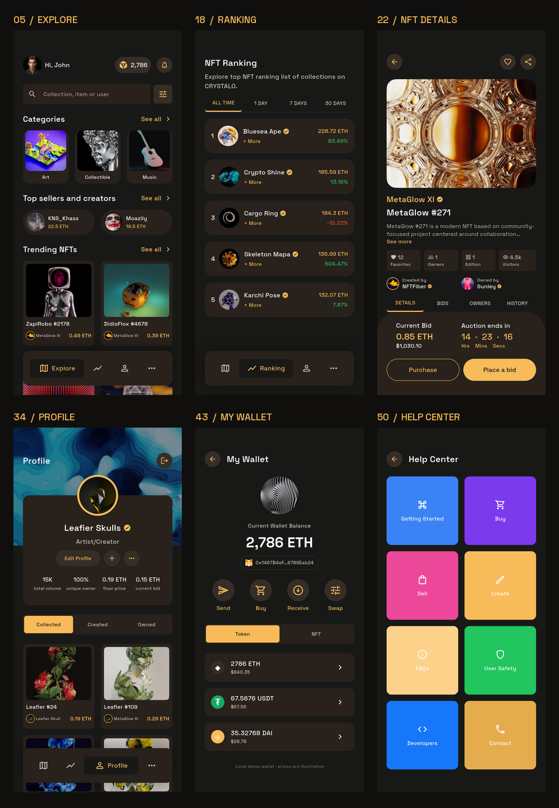

# Crystalo NFT Marketplace

根据 Pixso「Crystalo NFT App UI Kit」实现的 Flutter App，覆盖参考中的 **50 个页面与状态**。使用原稿导出的 NFT 图、头像、钱包图标和 Space Grotesk 字体，保留暖黑与琥珀金配色。

包含可操作的浏览、搜索筛选、收藏关注、出价购买、创建上架、资料编辑、钱包和设置流程。交易、登录与钱包均使用本地演示数据。

- [项目说明、架构与主要界面](docs/项目说明.md)
- [全部页面与截图索引](docs/页面截图索引.md)
- [模拟器验证结果](docs/qa-report.json)
- [Pixso 原始页面数据](docs/design-source.json)
- [验证记录](docs/验证记录.md)

已构建的安装包：

- [Android ARM64 手机安装包](dist/Crystalo-android-arm64.apk)
- [Android x64 模拟器安装包](dist/Crystalo-android-x64.apk)



## 启动

```sh
flutter pub get
flutter emulators --launch crystalo_review
flutter run -d emulator-5556
```

本次新建的专用模拟器名为 `crystalo_review`，测试后已关闭，保留了安装的 App。设备编号如有变化，先用 `flutter devices` 查看。也可在连接的真机运行；Web 预览使用 `flutter run -d chrome`。直接打开指定页面，例如首页：

```sh
flutter run --dart-define=SCREEN=5
```

App 内的 **More → Setting → About → Browse all 50 screens** 可浏览全部参考状态。

## 检查与构建

```sh
flutter analyze
flutter test --concurrency=1
flutter build apk --debug
flutter build apk --release --split-per-abi --target-platform android-arm64,android-x64
flutter build web
```

Android 构建输出到 `build/app/outputs/flutter-apk/`，本次交付包另存于 `dist/`。安装包采用演示签名，商店发布需配置正式签名。iOS 工程已准备好，需在 macOS 配置签名后构建。

本机 Web 构建输出到 `build_temp/web/`（当前 Flutter 的构建目录设置）。

## 重新生成截图

```sh
flutter drive --driver=test_driver/integration_test.dart --target=integration_test/app_test.dart -d emulator-5556 --keep-app-running
python tools/pull_screenshots.py
python tools/contact_sheet.py docs/screenshots
```

`docs/reference/` 是 Pixso 原始参考图，`docs/screenshots/` 是实际运行的 App 截图。两者独立保存，截图索引可逐页对照。

集成测试驱动会自动将截图导出到项目；`pull_screenshots.py` 可用于再次提取，需在测试 App 仍已安装时执行。制作联系表与总览图需要 Python、Pillow；运行 `python tools/make_overview.py` 可更新 README 的界面总览。
