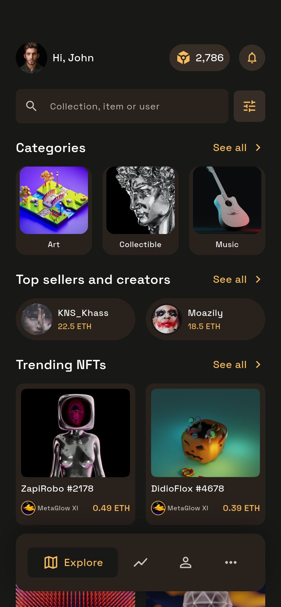
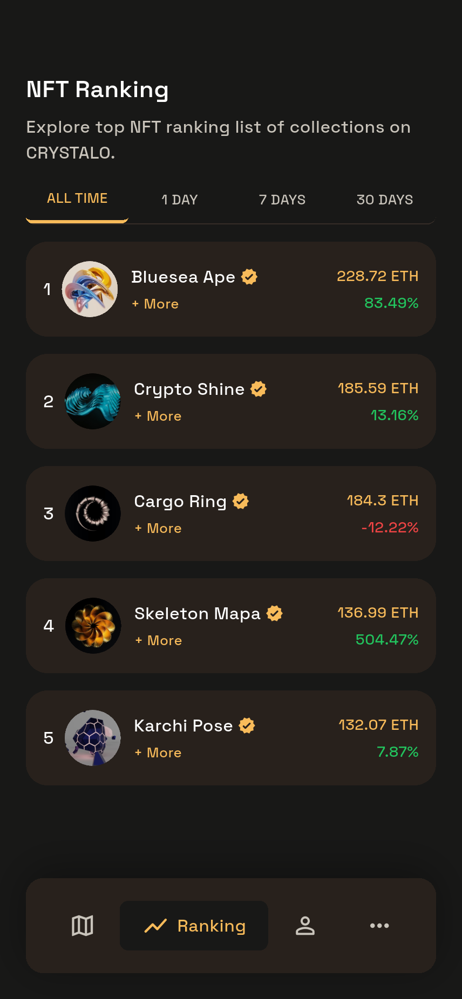
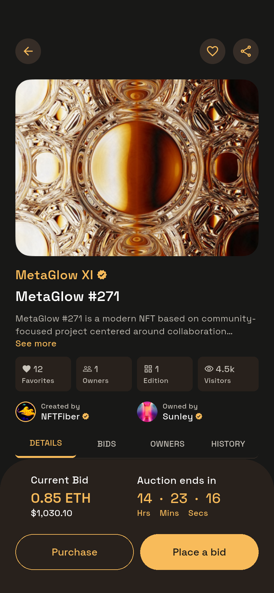
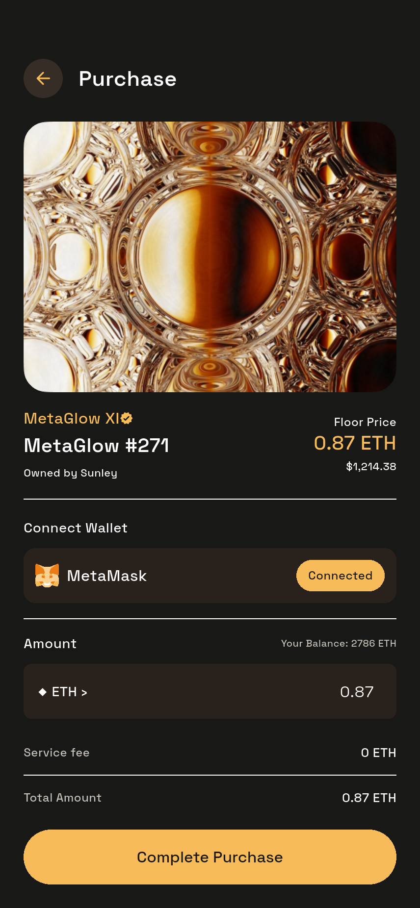
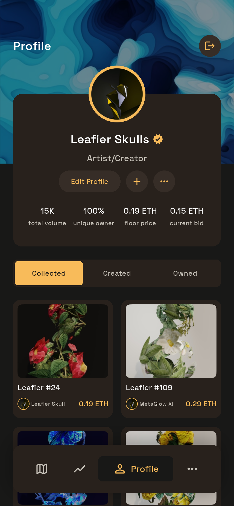
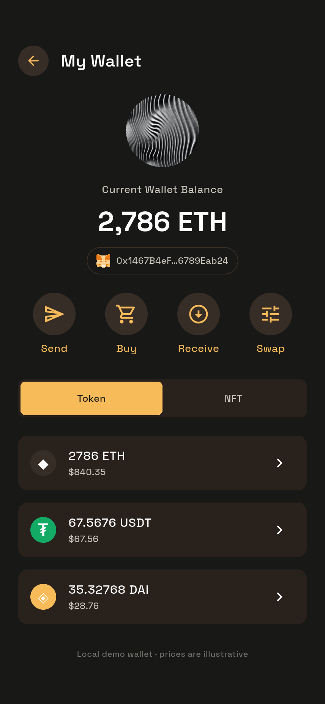
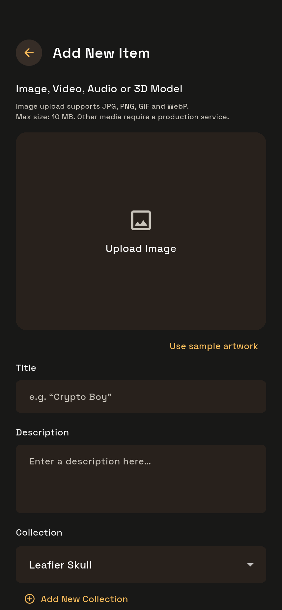
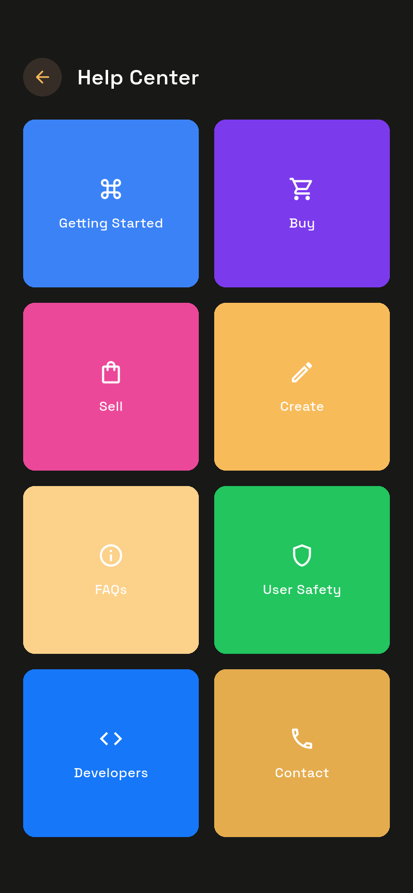
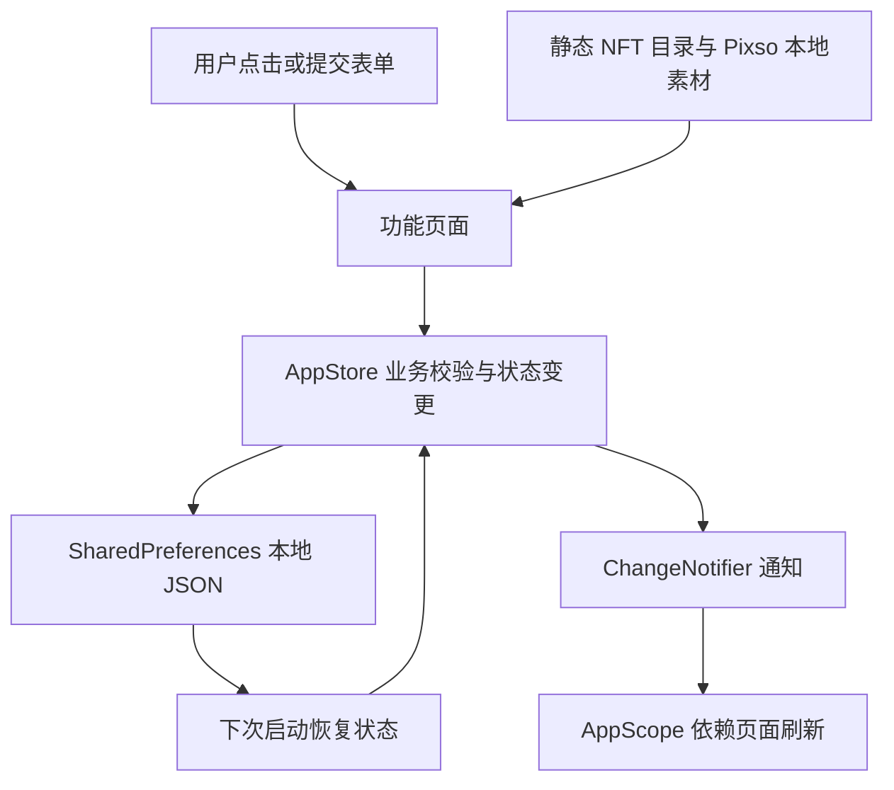

# Crystalo NFT Marketplace 项目说明

## 项目概述

本项目以 Pixso 中的 **Crystalo NFT App UI Kit** 为依据开发 Flutter App。设计文件包含「🔥Design System」和「📱Design Area」两个页面；开发读取了设计区全部 50 个页面状态及设计系统中的颜色、字体、尺寸信息。

实现重点是可运行的界面和连贯的本地交互：从引导、登录、市场浏览到查看 NFT、出价购买、个人资料、创建上架与钱包操作。首页长稿与手机视口稿、详情长稿与手机稿、成功弹层的不同样式分别保留页面编号，并在代码中复用。

本项目没有接入真实身份认证、区块链、支付或市场后端。界面内的连接钱包、出价、购买、发送、买币与兑换均明确标为演示操作；金额与价格不是实时行情。

## 主要界面

以下图片来自 Android 模拟器运行截图，完整截图见[页面截图索引](页面截图索引.md)。原始 Pixso 参考图单独保存在 `reference/`。

### 市场首页与 NFT 排行榜

首页包含分类横向列表、卖家与创作者、热门 NFT 和精选集合。底部四个入口连接 Explore、Ranking、Profile 和 More。

 

### NFT 详情与交易

详情页显示原稿的艺术作品、集合、作者、所有者、统计信息及 Details / Bids / Owners / History 标签。底部固定操作区连接购买与出价表单。

 

### 个人中心与钱包

个人中心提供 Collected / Created / Owned 分类、编辑资料和创建入口。钱包页面包含 ETH、USDT、DAI 示例持仓及发送、购买、收款、兑换入口。

 

### 创建 NFT 与帮助中心

创建表单支持系统图片选择器与示例作品。帮助中心的八个入口打开项目内的说明内容。

 

## 项目结构

```text
CrystaloNFTMarketplace/
├── lib/
│   ├── main.dart                   # 初始化本地存储、系统栏与 App
│   ├── app.dart                    # 应用根、主题、50 个设计状态的路由
│   ├── core/
│   │   ├── theme.dart              # 设计颜色、文字样式、控件主题
│   │   └── navigation.dart         # 页面编号、统一导航、提示
│   ├── data/
│   │   ├── catalog.dart            # NFT 模型与演示目录
│   │   └── app_store.dart          # 交互状态、业务校验、本地持久化
│   ├── shared/
│   │   └── widgets.dart            # 卡片、按钮、头像、导航、表单等
│   └── features/
│       ├── auth/auth_pages.dart    # 启动、引导、登录、选择钱包
│       ├── market/market_pages.dart# 首页、分类、搜索、筛选、排行
│       ├── nft/nft_pages.dart      # 集合、详情、分享、出价购买、成功层
│       ├── profile/profile_pages.dart # 个人中心、资料、创建、上架
│       ├── wallet/wallet_pages.dart# 钱包、发送、收款、买币、兑换
│       └── settings/settings_pages.dart # 更多、设置、通知、帮助、页面目录
├── assets/
│   ├── fonts/                      # Space Grotesk 与 OFL 字体许可证
│   └── images/                     # 从 Pixso 导出的独立图片和钱包 SVG
├── android/                        # Android 宿主
├── ios/                            # iOS 宿主与照片访问说明
├── web/                            # Web 宿主
├── test/
│   ├── app_store_test.dart         # 金额、持仓、持久化和筛选校验
│   ├── compact_screens_test.dart  # 360 × 800 小屏检查
│   └── screens_test.dart           # 428 × 926 基准尺寸检查
├── integration_test/app_test.dart  # Android 逐页截图与主要流程检查
├── test_driver/integration_test.dart # 集成测试报告写入
├── tools/
│   ├── pull_screenshots.py         # 从模拟器提取真实截图
│   └── contact_sheet.py            # 生成截图联系表便于复查
├── dist/                           # ARM64 / x64 安装包与 SHA256 校验值
└── docs/
    ├── 项目说明.md
    ├── 页面截图索引.md
    ├── qa-report.json              # 实际集成测试结果
    ├── design-source.json          # 50 个页面的 Pixso 节点与文案
    ├── asset-source.json           # 素材文件与 Pixso 节点对应关系
    ├── reference/                  # 50 张原稿导出图
    └── screenshots/                # App 实际页面及滚动区域截图
```

## 架构与数据流

采用 Flutter 自带的 `ChangeNotifier + InheritedNotifier` 管理共享状态。页面负责布局与局部表单状态，`AppStore` 负责业务校验、演示数据变更和持久化，`catalog.dart` 保存模型与静态数据。当前规模下无需额外引入状态管理或路由框架。



### 共享组件

- `AppPage`、`PageHeader`：统一安全区域、滚动区域、标题和底部操作。
- `BottomNav`：四个主入口，切换时替换主页面，避免重复堆积。
- `ArtImage`、`Avatar`、`Verified`：本地原稿图片、上传图片与认证标记。
- `NftCard`、`NftGrid`、`CollectionCard`：作品与集合列表的统一样式。
- `GoldButton`、`RoundAction`、`Segments`：主按钮、圆形操作与标签切换。
- `Field`、`SearchBox`、`KeyValue`、`Stats`：表单、搜索、键值和统计展示。
- `SuccessOverlay`：复用底部成功层与居中成功框。

### 路由组织

设计页面通过 `/screen/1` 至 `/screen/50` 定位。编号与原稿一致，便于验收、截图和问题定位。`/gallery` 提供页面目录，入口位于 More → Setting → About。

同类页面用参数区分，而不是复制整个页面：例如第 28～33 页复用交易表单和成功层，第 22～27 页复用详情页，第 39～40 页复用上架表单。5 / 6、14 / 15、16 / 17、22 / 24 的差异主要来自原稿画板高度；App 使用同一可滚动实现，实际手机截图可能相同，额外的 `_content` 图片展示其下方内容。

## 功能范围

| 模块 | 已实现行为 |
| --- | --- |
| 登录与钱包选择 | 用户名、密码长度校验；本地演示会话；Google / Apple 演示入口；钱包品牌与地址格式选择 |
| 浏览 | 分类、卖家、创作者、集合、NFT 页面之间跳转 |
| 搜索与筛选 | 按名称搜索；价格区间、分类、排序、演示销售状态筛选；清空与应用 |
| 收藏与关注 | NFT 收藏与创作者关注可切换，Favorites / Watchlist 可查看 |
| NFT 详情 | 四个信息标签、收藏、分享、购买与出价入口 |
| 出价 | 正数、有效数字、超过当前出价及余额校验，保存本地出价记录 |
| 购买 | 余额与重复购买校验；扣减演示余额并增加持有记录 |
| 个人资料 | 用户名、邮箱、简介、图片与社交链接的编辑和保存 |
| 创建 | 图片选择或示例作品；标题、描述、集合；创建后出现在 Created |
| 上架 | 固定价格 / 拍卖切换、价格校验与本地上架记录 |
| 钱包 | 演示余额、代币 / NFT 切换、ETH 发送、买入、兑换与近期活动 |
| 收款 | 根据有效演示地址生成真实二维码；设置请求金额、复制、系统分享 |
| 设置 | 通知开关与 Offers 状态保存；帮助文章、应用信息与全部页面目录 |

### 本地持久化

`SharedPreferences` 的 `crystalo.state` 字段保存收藏、关注、持有、创建作品、交易记录、个人资料、通知开关、演示余额和钱包品牌。上传图片以压缩后的 Base64 保存，适用于演示；正式项目应迁移到文件缓存和对象存储。密码、助记词和私钥不会保存。

### 与原稿的适配

- 设计基准为 428 × 926；页面采用弹性两列网格与可滚动内容，也检查了 360 × 800。
- 保留原稿英文 UI；本文档使用中文。原稿的明显拼写错误做了局部修正，例如 Receive。
- 使用原稿的 `#181817`、`#28211C`、`#F8BB5A` 等颜色；读取到的设计系统存在一处 Light Brown 标签与 HEX 不一致，实际取页面填充值。
- Android 使用真实系统栏与系统键盘，不绘制原稿的 iOS 假状态栏或键盘。个别通用图标采用 Flutter 图标，钱包图标使用原稿 SVG。
- 出价默认值调整为高于当前出价，避免原稿中当前 0.85 ETH 却填写 0.8 ETH 的矛盾。
- 原稿未显示的保存、校验和示例图片入口用于完成可操作流程。上传范围明确为图片，其余媒体需正式服务支持。

## 环境与运行

开发环境：Flutter 3.47.7、Dart 3.13.5、Android 15 / API 35 模拟器。

本次专用模拟器名为 `crystalo_review`，测试结束后已关闭。可以使用 `flutter emulators --launch crystalo_review` 再次启动，设备编号以 `flutter devices` 为准。原有模拟器的分辨率与密度已恢复。

```sh
flutter pub get
flutter run -d emulator-5556
```

首页直达：`flutter run --dart-define=SCREEN=5`。Web：`flutter run -d chrome`。

依赖仅包含原生图片选择、SVG、二维码、系统分享和本地存储；布局、导航、表单与状态通知使用 Flutter 自身能力。`pubspec.lock` 固定本次使用的版本。

## 验证与截图

```sh
flutter analyze
flutter test --concurrency=1
flutter drive --driver=test_driver/integration_test.dart --target=integration_test/app_test.dart -d emulator-5556 --keep-app-running
python tools/pull_screenshots.py
flutter build apk --debug
flutter build apk --release --split-per-abi --target-platform android-arm64,android-x64
flutter build web
```

布局测试遍历两种屏幕尺寸下全部 50 个状态，检查构建与布局异常。业务测试覆盖重复购买、无效出价、错误地址、余额不足、买入兑换和状态恢复。Android 集成测试执行收藏、出价、购买、资料保存、通知切换、创建、上架、筛选和搜索，同时保存各页截图。最终结果以 `qa-report.json` 和构建命令输出为准。

本次保存 **61 张 856 × 1852 的运行截图**：50 张主视口、10 张滚动内容、1 张实际创建并上架的成功状态。目录中另有 50 张 Pixso 参考图。完整结果见[验证记录](验证记录.md)。

`dist/` 提供 ARM64 手机与 x64 模拟器的正式模式 APK，采用演示签名；发布商店前需要配置生产签名。iOS 运行验证需在 macOS 完成。

## 后续正式接入位置

1. 将 `AppStore` 中的演示登录改为认证服务，返回会话令牌与用户资料。
2. 将静态目录改为分页 API；搜索、排序、筛选和市场统计由后端返回。
3. 钱包使用正式连接协议，由钱包完成签名；交易成功应等待链上确认并处理失败和待定状态。
4. 创建与上架连接媒体存储、元数据服务及合约，记录手续费、拍卖时间和可解锁内容。
5. 实时价格、支付渠道、通知投递、创作者收益与客服由对应生产服务提供。

## 代码精简

以功能模块组织页面，参数化复用 50 个设计状态；抽取高频 UI 组件，删除 Flutter 默认计数器示例、未使用依赖和导出素材。参考图与验证截图留在 `docs/`，不打包进 App。未生成 Windows / Linux / macOS 平台工程。

字体的 OFL 许可证保存在 `assets/fonts/OFL.txt`。UI 与艺术素材来源于用户提供的 Pixso 设计文件，`asset-source.json` 可追溯具体节点。
