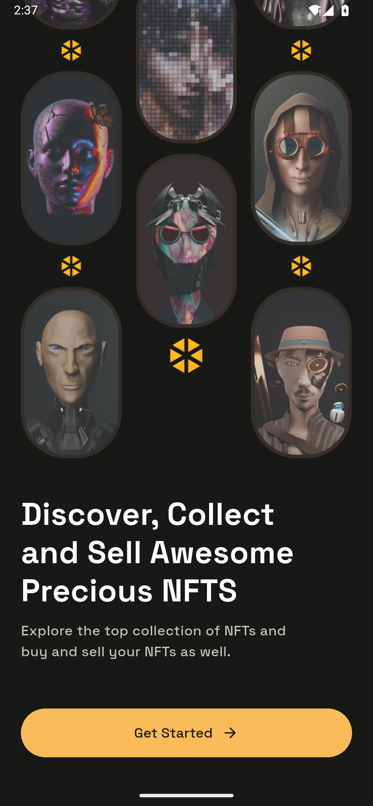

# 验证记录

验证日期：2026-10-26。

## 环境

- Flutter 3.47.7 stable / Dart 3.13.5。
- Android 15 / API 35，专用模拟器 `crystalo_review`。
- 截图逻辑尺寸 428 × 926，实际 PNG 为 856 × 1852。

## 已通过的检查

| 检查 | 结果 |
| --- | --- |
| `flutter analyze --no-pub` | No issues found |
| `flutter test --concurrency=1` | 10 项全部通过：8 项业务检查、2 项布局遍历 |
| 428 × 926 布局 | 全部 50 个页面状态无构建或布局异常 |
| 360 × 800 布局 | 全部 50 个页面状态无构建或布局异常 |
| Android 集成测试 | 收藏、出价、购买、资料保存、通知开关、创建、上架、筛选、搜索全部通过 |
| Android Debug 构建 | 成功 |
| Android ARM64 Release 构建 | 成功，30.7 MiB |
| Android x64 Release 构建 | 成功，32.2 MiB |
| Release 安装与启动 | x64 APK 安装成功，冷启动进入引导页，已目视检查 |
| Web 构建 | 成功，包含通过的 Wasm 兼容性预检查 |

可安装文件位于 `../dist/`，SHA256 校验值见 `../dist/SHA256SUMS.txt`。本机 Flutter 使用了自定义 Web 输出目录，生成文件位于 `../build_temp/web/`。

## 截图检查

共保存 61 张有效 PNG：50 张主页面、10 张滚动区域和 1 张真实创建并上架后的成功状态。逐页检查了截图联系表，并复查了主要界面、钱包选择、不同成功弹层和作品裁切。

图像完全相同的页面仅有以下四组：5 / 6、14 / 15、16 / 17、22 / 24。它们对应原稿中相同页面的长稿和手机视口稿，共用可滚动实现；其余主状态截图各不相同。长页下方内容另存 `_content` 图片。

Android 测试原始结果见 [qa-report.json](qa-report.json)，全部图片见 [页面截图索引](页面截图索引.md)。

## 实际边界

登录、出价、购买、创建上架与钱包操作为本地演示；没有调用真实认证、支付或链上交易。原生相册、剪贴板、二维码与系统分享使用对应平台能力。

iOS 工程已提供，但本次没有在 macOS 或 iOS 设备运行验证；Web 完成了编译检查，没有进行浏览器端完整流程测试。Android 验证使用模拟器，尚未进行物理手机测试。

测试后已关闭专用模拟器，保留了可再次启动的 AVD 与安装好的 Release App。原有模拟器的分辨率、密度和可用存储保持原状。
